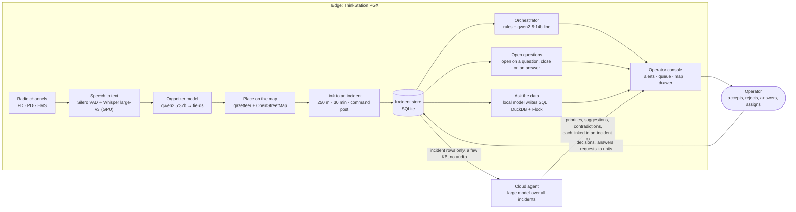

# FieldMind

**The edge listens to every channel. The cloud thinks over the whole fire. The operator decides.**

FieldMind is a hybrid AI console for wildfire radio traffic. It runs on a Lenovo ThinkStation
PGX (NVIDIA GB10, 128 GB unified memory). It listens to fire, police and EMS radio calls,
turns each call into an incident on a map, and tells the operator which incident needs
attention now. A cloud model reads the whole incident picture and makes suggestions. The
operator accepts or rejects each one.

The scenario is simulated on real geography: Paradise, California, on the morning of the 2018
Camp Fire. The streets come from OpenStreetMap, and the hazard zones come from CAL FIRE. The
radio calls were written for this exercise.

## How it works

**One radio call, step by step:**

1. **The call arrives** on a channel. In the demo, `scripts/play_radio.py` streams the recorded
   calls in 0.5 s pieces, the same way live radio would arrive.
2. **Speech to text.** The voice detector finds the end of the call. Whisper large-v3
   transcribes it on the GPU in about 2 to 4 s. The transcript appears in the radio feed.
3. **Fields.** The organizer model reads the transcript and returns the type, severity, place,
   people, structure part, fire direction and size, unit, department and needs, as JSON.
4. **Place.** The place name is matched against a gazetteer of Paradise streets and buildings
   from OpenStreetMap. If no match is found, the call is marked "Needs review: address not
   found".
5. **Link.** The call joins an existing incident within 250 m and 30 minutes, or the incident of
   the command post that signed it. Otherwise it makes a new incident with an ID such as
   FIRE-001. The ID follows the incident's type.
6. **Store.** The call (a report) and its incident are written to SQLite. Each incident keeps
   all its calls, with audio and transcript.
7. **Orchestrator.** Rules check severity, people, trapped people, burnover, schools, hospitals
   and evacuation routes. When the incident is new or worse, an alert appears in the banner.
8. **Questions.** If the call asks something, an open question appears under the map. If the
   call answers an earlier question, that question closes.
9. **Cloud.** The cloud agent reads the incident rows (no audio) and returns priorities and
   suggestions linked to incident IDs. The operator accepts or rejects each one.
10. **Operator.** The operator opens incidents, answers questions, asks units for information
    and assigns units. Each decision is logged.

## Hybrid design

| Part | Runs on | When | What it does |
|---|---|---|---|
| Speech to text | Edge (GPU) | Each call, in about 2 to 4 s | Whisper large-v3 transcribes the radio audio as it streams in. A voice detector (Silero VAD) finds the end of each call. |
| Organizer model | Edge | Each call, in about 15 to 35 s | qwen2.5:32b turns the transcript into fields: type, severity, place, people, part of the structure, fire direction and size, unit, department, needs. |
| Linking | Edge | Each call | A call joins an incident within 250 m and 30 minutes, or a call signed "X Command" joins the incident of that command post. Otherwise it makes a new incident. |
| Review flags | Edge | Each call | A call is marked "Needs review" only for reasons that the code can check: address not found, no location, unclear audio, a question in the call, a conflict with another incident, or a failed extraction. |
| Orchestrator | Edge | Each new or changed incident | Rules decide when to raise an alert. The fast model (qwen2.5:14b) writes one line about why. There is one alert per incident, and a new one only when the incident gets worse. |
| Open questions | Edge | Each call | A call that asks something opens a question. A later call that answers it closes it, and the fast model writes the answer. |
| Ask the data | Edge | On request | The local model writes one read-only SQL query. DuckDB runs it, with the Flock functions `llm_filter` and `llm_complete` for questions about the text of the calls. |
| Cloud agent | Cloud | Every 60 s when a key is set, or on request | A large model reads all incidents and returns priorities, suggestions, contradictions and open questions. Each item points to an incident ID. |

**What goes to the cloud:** only the structured incident rows, a few KB, with no audio. The
console shows the size of each upload. If the link drops, the edge continues, and the cloud
catches up when the link returns.

**In the demo, the cloud agent is a recorded response.** No API key is set on the demo
computer. The panel says "Recorded cloud response".

## The console

- **Top bar:** the town, the clock, the cloud status, and the counts of incidents and calls.
- **Demo row:** Reset demo, Start demo, Skip ahead 30 min, Ask cloud agent. The button to press
  next is red.
- **Alert banner:** the newest alert. Click it to open the incident. Earlier alerts are in a
  list under it.
- **Queue (left):** one row per incident: color bar, ID, type, people, place, age, review
  reason.
- **Map (center):** one pin per incident, colored by severity, with a type letter: F fire,
  M medical, T trapped, R road blocked, C collapse, O other. A dashed outline means "Needs
  review". Click a pin to open the incident.
- **Open questions (under the map):** one line with the number of open questions and the
  newest one. Open it to answer or dismiss each question.
- **Drawer (right):** the open incident: main facts, its open questions, "Ask a unit", and the
  radio timeline with audio and transcript for each call. With no incident open, it shows the
  live radio feed.
- **Tabs:** Ask the data, Units, Log (answered questions and decisions), Hardware, Data sources.

## Demo script (about 3 minutes)

1. **Reset demo.** The map of Paradise is empty.
2. **Start demo.** The 10 calls of part 1 stream in over about 2.5 minutes. Transcripts appear
   in the radio feed. The first pin appears about 40 to 50 s after the click. The banner shows
   FIRE-001 (Paradise High School, 123 people in the gym). No sound plays; press an audio
   player in the drawer to hear a call.
3. **Open FIRE-001.** Click the banner or the pin. Engine 81 and Battalion 3 are linked into one
   incident. Engine 35's unclear call ("Can anybody confirm?") is an open question under the
   map, not a guess.
4. **Skip ahead 30 min.** The console jumps 30 minutes ahead at once, as if the operator had
   watched 22 more calls come in. The data was made earlier by the same pipeline (see below).
   The burnover on Edgewood Lane is at the top. In Ask the data, try: *Which incidents have
   people trapped and no unit assigned?*
5. **Ask cloud agent.** The recorded cloud response shows priorities and suggestions linked to
   incident IDs. Accept or Reject writes to the decisions table.

**Skip ahead** loads `data/samples/skip_ahead.sqlite`. `scripts/build_skip_ahead.sh` makes
that file: it runs part 1 and the batch through the real pipeline on a second API (port 8010,
its own database). Skip ahead then shifts all times so that the batch calls spread over the
last 30 minutes.

## Run

On the PGX, in this folder:

    ./run.sh                          # Ollama and models, tile server, API, dashboard, watchdog
    scripts/build_skip_ahead.sh       # once, about 5 minutes: the state that Skip ahead loads

Open `http://<PGX address>:8501` from any computer on the same Wi-Fi. `run.sh` prints the
address. The browser loads Leaflet and jQuery from the internet, so that computer needs
internet access.

| Port | Service | Open to the Wi-Fi |
|---|---|---|
| 8501 | Dashboard (Streamlit) | Yes |
| 8008 | Map tiles and Leaflet (only `/tiles/` and `/vendor/`) | Yes |
| 8000 | API (FastAPI) | No, it has no login |
| 11434 | Ollama | No |

Tests: `scripts/test_extract.py --reset` (extraction on the sample reports),
`scripts/test_query.py` (Ask the data), `scripts/test_api.sh`.

## Limits

- The radio calls are simulated. Real radio has more noise, more overlap, and more people who
  talk at once.
- The extraction makes mistakes, for example a misheard street name. Every incident links to
  its calls and their audio, so the operator can check each fact.
- The organizer model takes 15 to 35 s per call. Many calls at the same time make it slower.
- The automatic closing of questions can match a question wrongly. Each automatic answer and
  its unit stay in the Log tab.
- The cloud agent in the demo is recorded, not live.

## Repository

| Path | Contents |
|---|---|
| `app/` | API, pipeline, extraction, linking, orchestrator, questions, query, cloud, map |
| `dashboard.py` | The operator console |
| `scripts/` | Start and stop scripts, radio replay, data preparation, tests |
| `data/samples/radio/` | The scenario calls (`camp_live.json`, `camp_batch.json`) and the recorded cloud response |
| `data/hazards/` | Hazard and perimeter layers; see `data/hazards/README.md` for sources and licenses |
| `data/tiles/`, `data/vendor/` | Offline map tiles and Leaflet |
